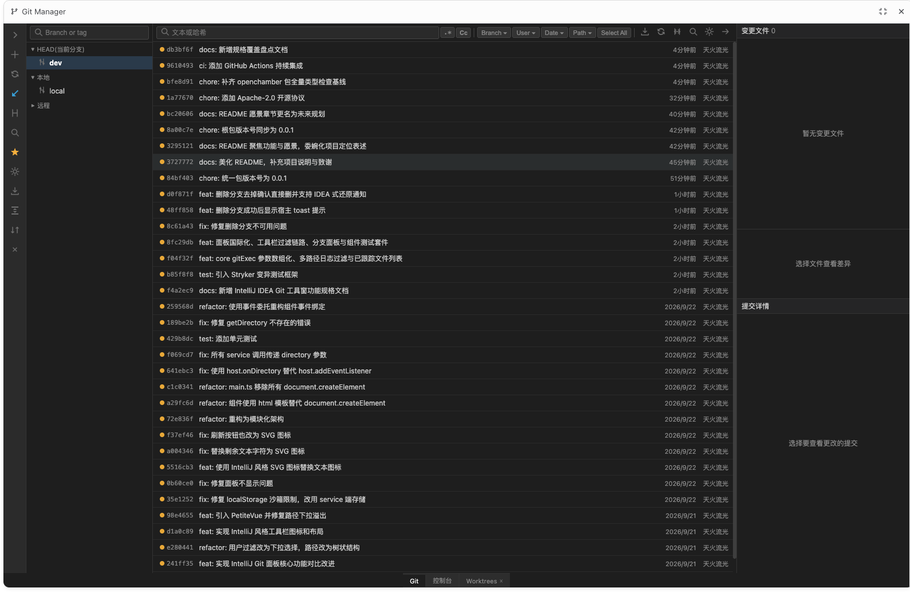

**언어**: [简体中文](README.md) · [繁體中文](README.zh-TW.md) · [English](README.en.md) · [Deutsch](README.de.md) · [Français](README.fr.md) · [Español](README.es.md) · [Português (Brasil)](README.pt-BR.md) · [Українська](README.uk.md) · [Polski](README.pl.md) · **한국어** · [日本語](README.ja.md) · [Türkçe](README.tr.md)

# Git Manage

[OpenChamber](https://docs.openchamber.dev/sdk/) 확장으로 제공되는 크로스 플랫폼 Git 그래픽 관리 도구입니다. 인터페이스는 IntelliJ IDEA의 Git 도구 창을 충실히 따르므로, IDE 스타일 Git 워크플로에 익숙한 개발자가 어디서든 곧바로 익숙한 브랜치 관리, 커밋 탐색, 차이 비교를 사용할 수 있습니다.

## 기능

- **브랜치 관리**: 로컬·원격 브랜치를 그룹으로 탐색하고 즐겨찾기를 지정하며, 생성·이름 변경·전환·삭제를 클릭 한 번으로 처리합니다. 삭제 전에 브랜치 위치를 기록하므로 실수로 삭제해도 알림에서 바로 되돌릴 수 있습니다. 병합되지 않은 브랜치는 명확히 표시되고, 현재 브랜치는 실수를 막기 위해 잠깁니다
- **커밋 기록**: 그래프와 상세 정보가 있는 커밋 목록, cherry-pick·revert·stash 같은 주요 작업 지원
- **차이 비교**: 파일 단위와 커밋 단위 차이 보기, 직관적인 스테이징 관리
- **스마트 필터**: 대소문자, 정규식, 브랜치, 작성자, 날짜, 경로를 조합해 필터링하며, 경로는 IDEA 스타일 트리 다중 선택을 지원합니다
- **다국어 인터페이스**: 중국어, 영어, 일본어, 한국어, 독일어, 프랑스어 등 12개 언어 내장. UI 문구와 날짜 형식은 시스템 언어에 맞춰 자동으로 바뀌며, 자세한 내용은 [i18n 안내](packages/openchamber/I18N.md)를 참고하세요

## 로드맵

- 전문적인 Git 시각화를 특정 편집기에 묶지 않고, 어떤 환경에서도 편안한 브랜치·커밋 경험 제공
- 핵심 기능을 독립적으로 다듬어 OpenChamber, VSCode 및 더 많은 플랫폼으로 확장
- 성숙한 IDE를 기준으로 인터랙션 디테일을 계속 다듬어 모든 클릭이 자연스럽게 느껴지도록 개선
- 오픈 소스로 함께 만들어 갑니다. 관심과 참여를 환영합니다

## 감사의 글

- [JetBrains intellij-community](https://github.com/JetBrains/intellij-community) — Git 도구 창의 설계와 구현은 이 프로젝트의 가장 중요한 참고 자료입니다 (Apache 2.0 라이선스)
- [DetachHead/rebased](https://github.com/DetachHead/rebased) — Git 관리 패널 기능의 중요한 참고 자료입니다

## 라이선스

이 프로젝트는 [Apache License 2.0](LICENSE)으로 공개되며, Copyright 2026 GuoChen-thlg.
